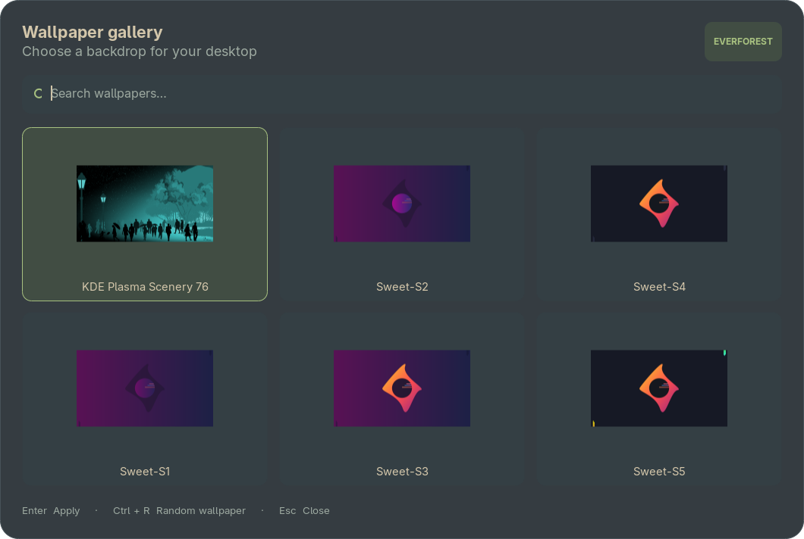
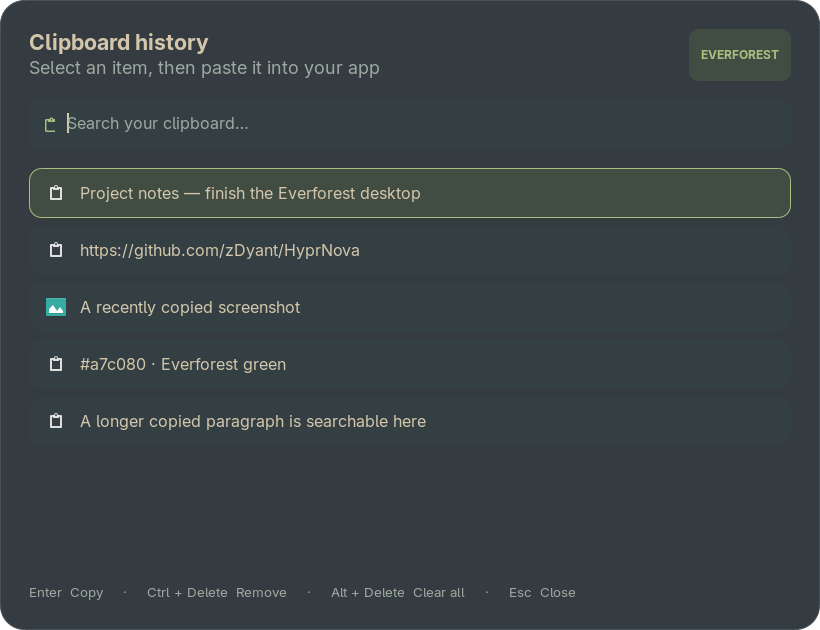
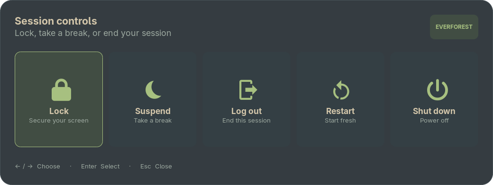

# Everforest · Hyprland

A personal Arch Linux desktop with a modular **Lua Hyprland configuration**, soft motion, and a consistent Everforest palette.

This is a reusable snapshot of the working desktop, captured on **5 November 2026**. It includes the settings, helper scripts, artwork, package lists, and an optional startup login theme.



## What is included

| Component | Configuration |
|---|---|
| Hyprland | Lua modules for monitors, appearance, animations, input, shortcuts, startup, layouts, and rules |
| Desktop menus | Wallpaper thumbnail gallery, clipboard history, and power-action cards |
| Notifications | SwayNC panel with Everforest colours and ten utility buttons |
| Status bar | Waybar, with separate audio-volume and Bluetooth-battery indicators |
| Lock screen | Hyprlock with clock, date, battery status, track title, and play/pause |
| Idle management | Lock after 5 idle minutes; displays off after 10; lock before sleep |
| Wi-Fi | A graphical network picker with a password field and connect/disconnect controls |
| Terminal | Kitty colour theme; optional Zsh and Powerlevel10k settings |
| App appearance | GTK settings, bundled Everforest-Green-Dark theme, and Papirus-Dark selection |
| Startup login | Optional Everforest Minimal SDDM theme |
| Artwork | Wallpaper collection, the captured current wallpaper, and launcher images |

The backup excludes Wi-Fi credentials, clipboard contents, browser profiles, SSH keys, cloud credentials, logs, and old configuration backups. System package versions are saved as a reference; they are not all reinstalled by the setup script.

## Quick restore on Arch Linux

Use your **normal user account**, not a root shell. The restore tool previews changes by default and backs up existing files when you apply them.

### 1. Get the files

From the downloadable archive:

```bash
tar -xzf everforest-dotfiles-2026-11-05.tar.gz
cd everforest-dotfiles
```

Or, after this folder has been published to GitHub:

```bash
git clone https://github.com/JustAthought00/everforest-dotfiles.git
cd everforest-dotfiles
```

### 2. Install the desktop packages

Review the package command first, then apply it:

```bash
bash scripts/install-packages.sh
bash scripts/install-packages.sh --apply
```

This performs an Arch system update and installs the packages in `packages/official.txt`. It does not enable a display manager or restart your desktop.

Optional login-screen and utility packages:

```bash
sudo pacman -S --needed sddm qt6-declarative qt6-svg dolphin xsettingsd
sudo systemctl enable --now NetworkManager
```

The active GTK theme is already bundled; an AUR helper is not required for restoring it. `packages/aur-optional.txt` lists optional upstream packages for future theme updates.

### 3. Preview and restore your settings

```bash
python3 restore.py --dry-run
python3 restore.py --apply
```

Existing versions are backed up under:

```text
~/.local/state/everforest-dotfiles/backups/<timestamp>/
```

This restores the desktop files and adds a small PATH-loader line to `.zshrc`, preserving your existing shell configuration. Full shell restoration is optional; see [the restore guide](docs/RESTORE.md#optional-zsh-and-powerlevel10k).

### 4. Adapt the two hardware-specific settings

Before your next Hyprland login, review:

- `~/.config/hypr/modules/monitors.lua` — display names, resolutions, scaling, and positions.
- `~/.config/waybar/config.jsonc` — the Wi-Fi interface is currently `wlo1`.

Useful inspection commands inside a desktop session:

```bash
hyprctl monitors
nmcli -t -f DEVICE,TYPE device status
```

The captured display layout uses an **eDP-1 laptop screen at 1366×768** and an **HDMI-A-1 monitor at 2560×1440**. Change these values for another machine.

### 5. Apply the theme and wallpaper

After logging into Hyprland:

```bash
hyprctl reload
hyprctl configerrors
gsettings set org.gnome.desktop.interface gtk-theme 'Everforest-Green-Dark'
gsettings set org.gnome.desktop.interface icon-theme 'Papirus-Dark'
nwg-look -a
~/.local/bin/wallpaper ~/.local/share/wallpapers/saved-current.jpg
```

Open a new terminal so the personal command directory is on PATH. The wallpaper daemon restores its cached selection on subsequent logins.

For green Papirus folders:

```bash
sudo ~/.local/bin/papirus-folders -C green --theme Papirus-Dark
```

### 6. Optional: install the startup login theme

Preview it first:

```bash
sddm-greeter-qt6 --test-mode --theme "$PWD/system/usr/share/sddm/themes/everforest-minimal"
```

Close the preview, then install:

```bash
bash scripts/install-sddm.sh
bash scripts/install-sddm.sh --apply
```

The installer backs up the previous theme settings and does **not** restart SDDM. If SDDM is already your display manager, the next login uses the selected theme. For a fresh system without another display manager, enable it for the next boot:

```bash
sudo systemctl enable sddm
```

## Everyday shortcuts

| Shortcut | Action |
|---|---|
| Super + Q | Terminal |
| Super + D | App launcher |
| Super + E | File manager |
| Super + C | Close the focused window |
| Super + F | Fullscreen |
| Super + V | Toggle floating mode |
| Super + W | Wallpaper gallery |
| Super + Shift + V | Clipboard history |
| Super + X | Power menu |
| Super + L | Lock screen |
| Super + 1…0 | Switch workspace |
| Super + Shift + 1…0 | Move a window to a workspace |
| Super + arrow key | Move focus |

`Super` is normally the Windows key. The older **Super + M** binding exits Hyprland; use **Super + X** for the confirmation-based power menu instead.

Wallpaper gallery: **Ctrl + R** picks a random image. Clipboard history: **Ctrl + Delete** removes one entry; **Alt + Delete** clears history after confirmation.

## Configuration map

```text
home/
├── .config/
│   ├── hypr/           # hyprland.lua, modules/, lock/idle settings, scripts/
│   ├── rofi/           # app launcher and Everforest menu themes
│   ├── waybar/         # bar layout, colours, and CSS
│   ├── swaync/         # notification panel, buttons, and CSS
│   ├── kitty/          # terminal settings and colour theme
│   ├── gtk-3.0/        # GTK appearance
│   ├── gtk-4.0/
│   └── everforest/     # PATH helper for personal commands
└── .local/
    ├── bin/            # wallpaper and papirus-folders commands
    └── share/          # wallpapers, GTK theme, and nwg-look preferences
shell/                  # optional .zshrc and .p10k.zsh
system/                 # optional SDDM theme and selection file
packages/               # package lists and captured versions
scripts/                # installers and snapshot utility
manifest.json           # per-file checksums and restore destinations
```

Edit `~/.config/hypr/modules/appearance.lua` for gaps, rounding, blur, and shadows; `animations.lua` for motion; and `keybindings.lua` for shortcuts. Keep `hyprland.lua` as the module loader.

## Guides

- [Restore, rollback, and shell setup](docs/RESTORE.md)
- [Command reference and troubleshooting](docs/COMMANDS.md)
- [Make another backup and publish to GitHub](docs/BACKUP.md)
- [Snapshot details and known limitations](docs/SNAPSHOT.md)
- [Sources and licences](docs/CREDITS.md)

## More previews

### Clipboard history

The preview uses sample entries, not private clipboard contents.



### Power menu



## Compatibility

This configuration uses **Lua**, not the older `hyprland.conf` format. It was captured with Hyprland **0.57.1**, Rofi **2.0.0**, SwayNC **0.12.6**, Waybar **0.15.0**, Hyprlock **0.9.7**, and SDDM **0.21.0 / Qt 6**. See `packages/installed-versions.txt` for the package inventory. Review upstream changes when restoring onto newer releases.
